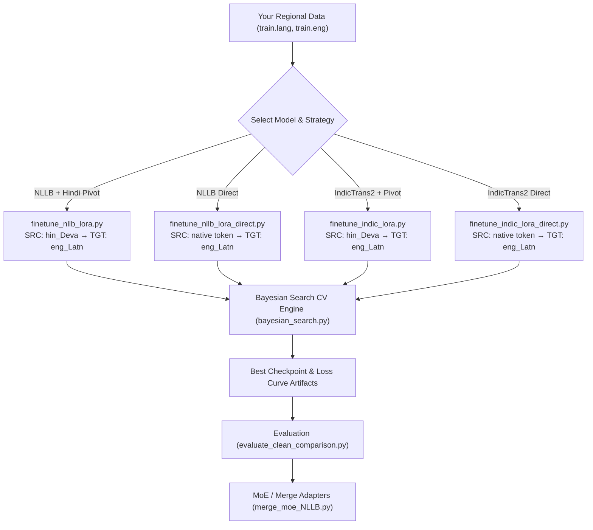

# AGENT.MD: Autonomous Agent Guide for Indic-to-English Model Fine-Tuning

> **Target Audience**: AI Agents collaborating on this multi-regional Indic translation project.
> *(For human teammates looking for a quick 3-minute summary, see [TEAMMATE_GUIDE.md](TEAMMATE_GUIDE.md)).*
> **Project Goal**: Fine-tune foundation models (**NLLB-200** and **IndicTrans2**) using LoRA and Bayesian Hyperparameter Search to translate regional Indic languages into English (**English ↔ Rajasthani, Haryanvi, Odia, Bengali**), followed by Mixture-of-Experts (MoE) / adapter merging.

---

## 1. Codebase Architecture & Directory Map

The repository is structured to separate active pipelines from historical/data preparation scripts:

```text
Raj_en_nllb200_meta_model/
├── agent.md                          # THIS GUIDE: Primary handbook for autonomous agents
├── requirements.txt                  # Full project dependencies (torch, transformers, peft, etc.)
├── install_deps.sh                   # Auto-installer & environment verifier (./install_deps.sh --check)
├── pyproject.toml                    # UV / Pip dependency manifest
│
├── scripts for fintuning/            # ⭐ ACTIVE PIPELINE DIRECTORY (Do not rename)
│   ├── finetune_nllb_lora.py         # NLLB-200 LoRA (Hindi Pivot) + Bayesian Search
│   ├── finetune_nllb_lora_direct.py  # NLLB-200 LoRA (Direct Translation) + Bayesian Search
│   ├── finetune_indic_lora.py        # IndicTrans2-1B LoRA (Hindi Pivot) + Bayesian Search
│   ├── finetune_indic_lora_direct.py # IndicTrans2-1B LoRA (Direct Translation) + Bayesian Search
│   ├── bayesian_search.py            # Gaussian Process Bayesian CV engine & Loss Tracker
│   ├── evaluate_clean_comparison.py  # Full evaluation suite (BLEU, chrF, chrF++, Acc, SemAcc)
│   ├── evaluate_indic_lora.py        # IndicTrans2 checkpoint evaluator
│   ├── evaluate_lora.py              # NLLB LoRA checkpoint evaluator
│   ├── visualize_results.py          # Generates comparison tables & interactive HTML
│   ├── merge_moe_NLLB.py             # Multi-adapter LoRA merger / MoE router
│   ├── run_it                        # Quick workflow instructions
│   └── test setup/                   # 16-test automated smoke test suite
│       ├── run_all_smoke_tests.py    # Master runner for all smoke tests
│       ├── smoke_helper.py           # Reusable test harness & mock datasets
│       └── smokeTest_<model>_<mode>_<lang>_eng.py
│
├── data_split/                       # Directory where parallel splits are placed
│   ├── train.<lang>, train.eng       # Training sentence pairs
│   ├── val.<lang>, val.eng           # Validation sentence pairs
│   └── test.<lang>, test.eng         # Unseen clean test pairs
│
├── comparison_outputs_clean/         # Evaluation metric logs & prediction text files
└── extra_scripts/                    # Archive of historical/data-cleaning scripts (read-only)
    ├── data_pipeline/                # (back_translate, build_corpus, labse_filter, etc.)
    └── early_experiments/            # (historical baseline scripts)
```

---

## 2. Language Codes & Token Mappings

Both foundation models require explicit language token identifiers. Use the table below when switching to your language:

| Language | Code | NLLB-200 Token (`nllb`) | IndicTrans2 Token (`indic`) | Pivot Strategy |
| :--- | :---: | :---: | :---: | :--- |
| **Rajasthani** | `raj` | `hin_Deva` | `hin_Deva` (or `raj_Deva`) | Script & grammar share high mutual intelligibility with Hindi. |
| **Haryanvi** | `har` | `hin_Deva` | `hin_Deva` (or `har_Deva`) | Western Hindi dialect; maps cleanly via Devanagari Hindi pivot. |
| **Odia** | `odia` | `ory_Orya` | `ory_Orya` | Natively supported in both tokenizers in Odia script. |
| **Bengali** | `ben` | `ben_Beng` | `ben_Beng` | Natively supported in both tokenizers in Bengali script. |
| **English** | `eng` | `eng_Latn` | `eng_Latn` | Universal target language. |

---

## 3. How to Plug in Your Own Language Data

### Step 1: Format Parallel Files
Ensure your data consists of plain UTF-8 text files where line $N$ in the source file matches line $N$ in the target file:

```text
data_split/
├── train.<src_lang>    # e.g., train.har or train.odia
├── train.eng           # Corresponding English sentences
├── val.<src_lang>      # Validation split (~10-20% of train)
├── val.eng
├── test.<src_lang>     # Blind test split for evaluation
└── test.eng
```

### Step 2: Configure Fine-Tuning Scripts
Open the script corresponding to your desired approach in `scripts for fintuning/`:

1. Change the source and target tokens:
   ```python
   # In finetune_nllb_lora.py (Hindi Pivot):
   SRC_LANG = "hin_Deva"   # Pivot token for NLLB
   TGT_LANG = "eng_Latn"
   
   # Or in direct scripts:
   SRC_LANG = "ory_Orya"   # For Odia
   # SRC_LANG = "ben_Beng" # For Bengali
   ```

2. Point the data paths to your language:
   ```python
   TRAIN_SRC = resolve_path("train.<your_lang>")
   TRAIN_TGT = resolve_path("train.eng")
   VAL_SRC   = resolve_path("val.<your_lang>")
   VAL_TGT   = resolve_path("val.eng")
   OUTPUT_DIR = "nllb_lora_<your_lang>_pivot"
   ```

---

## 4. The 4 Fine-Tuning Approaches

Agents must decide which approach (or combination) best suits their language pair:



### Approach 1: `finetune_nllb_lora.py` (NLLB Hindi Pivot)
- **Best for**: `raj` and `har`.
- **Why**: Rajasthani and Haryanvi are low-resource dialects not explicitly present in NLLB-200's vocabulary, but share Devanagari script and grammatical structure with Hindi. By using `hin_Deva`, the model leverages its vast pre-trained Hindi-to-English alignment.

### Approach 2: `finetune_nllb_lora_direct.py` (NLLB Direct)
- **Best for**: `odia` (`ory_Orya`) and `ben` (`ben_Beng`).
- **Why**: NLLB natively contains `ory_Orya` and `ben_Beng` tokens. Fine-tuning directly trains adapter representations without proxy translation bias.

### Approach 3: `finetune_indic_lora.py` (IndicTrans2 Hindi Pivot)
- **Best for**: Dialectal transfer into `ai4bharat/indictrans2-indic-en-1B` using `IndicProcessor`.

### Approach 4: `finetune_indic_lora_direct.py` (IndicTrans2 Direct)
- **Best for**: High-fidelity Indian language translation with native IndicTrans2 tokenizer mappings.

---

## 5. Bayesian Optimization & Loss Tracking Engine

Every fine-tuning script is integrated with `bayesian_search.py`. Agents do not need to install extra search packages; it operates directly using `scikit-learn`'s `GaussianProcessRegressor` and Expected Improvement (EI).

### Search Space Configuration
```python
N_TRIALS = 10
SEARCH_SPACE = {
    "lr": (5e-6, 1e-3, "log"),                 # Continuous log-uniform learning rate
    "r": [4, 8, 16, 32, 64, 128],              # LoRA rank (parameter capacity)
    "lora_alpha": [8, 16, 32, 64, 128],        # LoRA scaling factor (alpha / r)
    "lora_dropout": [0.0, 0.05, 0.1, 0.15, 0.2, 0.3], # Regularization against overfitting
}
```

### Generated Artifacts
After running `bayesian_search_cv()`, the following publication-ready files are automatically saved in `OUTPUT_DIR`:
1. **`loss_curve.png`**: 300 DPI plot showing training loss vs. validation loss across epochs, marking the global minimum validation point.
2. **`loss_curve.pdf`**: Publication-quality vector PDF ready for inclusion in LaTeX papers.
3. **`loss_curve_history.csv`**: Raw numeric table with `[epoch, step, train_loss, val_loss, lr]`.
4. **`bayesian_optimization_convergence.png`**: Step-by-step optimization trajectory showing trial progression.
5. **`best_params.json`**: Exact winning hyperparameter dictionary.
6. **`best_model/`**: Serialized PEFT LoRA adapter checkpoint (`adapter_model.safetensors`, `adapter_config.json`).

---

## 6. Pre-Flight Check: Smoke Testing

**Crucial Agent Rule**: Never start a full training run without first verifying that your tokenizer, collator, and environment pass smoke tests.

Run the pre-configured smoke test for your specific language:
```bash
# Example: Smoke test NLLB Pivot for Haryanvi
python3 "scripts for fintuning/test setup/smokeTest_nllb_pivot_har_eng.py"

# Example: Smoke test IndicTrans2 Direct for Odia
python3 "scripts for fintuning/test setup/smokeTest_indic_not_odia_eng.py"

# Run all 16 smoke tests across all 4 approaches and 4 languages:
python3 "scripts for fintuning/test setup/run_all_smoke_tests.py"
```

If a smoke test passes, it prints:
```text
======================================================================
 SUCCESS: Smoke test passed for nllb_pivot_har_eng!
======================================================================
```

---

## 7. GPU Optimization Guide (20 GB VRAM)

The default parameters in `scripts for fintuning/` are set to CPU-safe limits (`batch_size = 1`). When deploying to your **20 GB GPU**, modify the configuration block in your training script:

```python
# ================= 20 GB GPU OPTIMIZATION =================
TRAIN_BATCH_SIZE = 16          # Increase from 1 to 16 (or 8 for IndicTrans2-1B)
EVAL_BATCH_SIZE  = 16          # Fast evaluation
GRAD_ACCUM       = 2           # Effective batch size = 16 * 2 = 32
MAX_LEN          = 128         # Sufficient for most conversational/parallel sentences
EPOCHS           = 5           # 5-10 epochs is optimal with EarlyStopping(patience=2)

# In Seq2SeqTrainingArguments:
fp16 = True                    # Or bf16 = True (NVIDIA Ampere / Ada / Hopper)
dataloader_num_workers = 4     # Fast data loading
```

### VRAM Budget Breakdown on 20 GB GPU:
- **NLLB-200 (600M) Base in FP16**: $\approx 1.2\text{ GB}$
- **LoRA Adapter Weights ($r=128$)**: $\approx 0.05\text{ GB}$
- **AdamW Optimizer States (LoRA only)**: $\approx 0.2\text{ GB}$
- **Activation Cache (Batch=16, Len=128)**: $\approx 3.5\text{ GB}$
- **Total VRAM Used**: $\approx 5.0\text{ GB}$ (Leaving $>14\text{ GB}$ headroom!)

---

## 8. Evaluation Suite (All 5 Metrics)

Our project uses a 5-metric evaluation protocol to evaluate translation fidelity, character precision, and deep semantic meaning:

1. **BLEU** (`sacrebleu.corpus_bleu`): Standard n-gram precision.
2. **chrF** (`CHRF(word_order=0)`): Character n-gram score; vital for morphologically rich Indic languages.
3. **chrF++** (`CHRF(word_order=2)`): Character + word bigram overlap.
4. **Exact Accuracy** (`acc`): Percentage of predictions that strictly match reference after whitespace/case normalization.
5. **Semantic Accuracy** (`sem_acc`): Cosine similarity ($0\text{--}100\%$) between sentence embeddings (`sentence-transformers/all-MiniLM-L6-v2`) with character-level TF-IDF fallback.

### Running Evaluation:
```bash
python3 "scripts for fintuning/evaluate_clean_comparison.py"
```

Output format:
```text
========================= FINAL COMPARISON =========================
Model                   BLEU    chrF   chrF++   ExactAcc  SemanticAcc
--------------------------------------------------------------------
Zero-Shot NLLB          4.47   25.02    24.10      0.00%     42.15%
LoRA Fine-Tuned NLLB    8.12   32.40    31.55      5.20%     68.80%
====================================================================
```
Results and sample translations are automatically logged to `comparison_outputs_clean/metrics.csv`.

---

## 9. Merging Adapters / Mixture-of-Experts (`merge_moe_NLLB.py`)

Once each teammate finishes fine-tuning their language adapter (`raj`, `har`, `odia`, `ben`), the 4 LoRA adapters can be merged into a single multi-dialect translator:

```bash
python3 "scripts for fintuning/merge_moe_NLLB.py" \
    --base_model "facebook/nllb-200-distilled-600M" \
    --adapters "nllb_lora_raj" "nllb_lora_har" "nllb_lora_odia" "nllb_lora_ben" \
    --output_dir "nllb_multilingual_moe"
```

---

## 10. Autonomous Agent Execution Checklist

Before reporting completion to your human operator, ensure your agent has completed this checklist:

- [ ] **Environment verified**: Run `./install_deps.sh --check` with 0 missing modules.
- [ ] **Data verified**: Parallel source and target files in `data_split/` have identical line counts.
- [ ] **Smoke test passed**: Executed `smokeTest_<model>_<mode>_<lang>_eng.py` without exceptions.
- [ ] **GPU configured**: `fp16=True` (or `bf16=True`) and `batch_size>=8` set for 20 GB GPU.
- [ ] **Bayesian CV completed**: Generated `best_params.json` and saved adapter in `OUTPUT_DIR`.
- [ ] **Plots verified**: `loss_curve.png`, `loss_curve.pdf`, and `loss_curve_history.csv` exist.
- [ ] **Evaluation scored**: Computed all 5 metrics (`BLEU`, `chrF`, `chrF++`, `Acc`, `SemAcc`) on test split.

